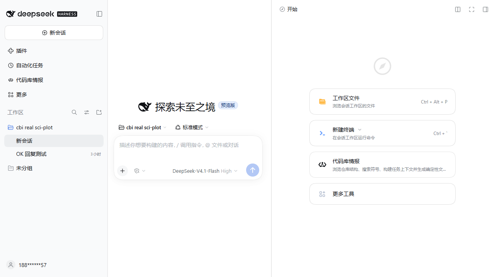

# Start-guide style acceptance

Date: 2026-11-11 (Windows 11, DSH 0.2.2-rc.1, isolated profile)

Goal: make the Codebase Intelligence Start-guide row in the right sidebar look
like a native DSH row instead of a default browser button, so the plugin does
not visually break the host list.

## Target measured from the host

Measured live in the isolated DSH at 1280×800, light theme:

| Property | Native DSH row (`.geFEbW_entry`) |
|---|---|
| Box | 380 × 68 px |
| Layout | `display: flex`, row, centered |
| Gap / padding | `14px` / `14px 20px` |
| Border | `1px solid rgba(0, 0, 0, 0.12)` |
| Radius | `20px` |
| Background | `--dsw-alias-bg-layer-1` (white in light) |
| Icon | 26 × 26 px, left |
| Title | 14 px / 400 / 19.6 px line-height |
| Description | 11 px / 15.4 px line-height, tertiary label |

## What changed

1. `src/client/04-panel.js` now mounts the namespaced stylesheet once in
   `document.head` via `ensureGlobalStyles()` (also called from `apply`). The
   Start-guide card is rendered outside `.cbi-root`, so the panel-local
   `<style>` element never reached it; that was the root cause of the default
   button styling.
2. `src/client/01-styles.js` shares the `--cbi-*` token declarations between
   `.cbi-root` and `.cbi-guide-entry`, then styles the guide as a host row:
   26 px icon, title/description stack, 14 px gap, 14/20 px padding, 20 px
   radius, one-line ellipsis, token-based hover and focus-visible states.
3. `GuideEntryCard` markup now mirrors the native row hierarchy:
   `.cbi-guide-entry > .cbi-guide-icon + .cbi-guide-text >
   .cbi-guide-title + .cbi-guide-desc` (the old flat title/description stack
   did not match the host's row language).
4. All selectors stay `cbi-*`; no global variable overrides, no changes to the
   panel data cells, graph interaction logic, tool schemas or prompt footprint.

## Result

Measured after the change in the same live page:

| Property | Plugin row | Native row |
|---|---|---|
| Box | 380 × 68 px | 380 × 68 px |
| Display / direction / align | flex / row / center | flex / row / center |
| Gap / padding | 14 / 14px 20px | 14 / 14px 20px |
| Radius | 20px | 20px |
| Border | 1px rgba(0, 0, 0, 0.10) (DSH `border-l2` token) | 1px rgba(0, 0, 0, 0.12) |
| Background | `--dsw-alias-bg-layer-1` | `--dsw-alias-bg-layer-1` |
| Icon | 26 × 26 px | 26 × 26 px |

The remaining border-alpha difference is the DSH token value nearest to the
host's literal; using the token keeps dark and light themes consistent instead
of hard-coding a colour. The isolated instance is in light theme; the same row
uses `--dsw-*` tokens in dark theme.

## Verification

- `node --test test/unit/*.test.mjs` — **106 passed, 0 failed** (includes a new
  structural test for the native row markup).
- `node scripts/build-client.mjs --check` — up to date, **201,197 bytes**, 253
  locale keys, under the 224 KiB cap.
- `npm run check` — clean.
- `node scripts/footprint.mjs` — tool schema **1189** + prompt **184** = **1373**
  estimated tokens; unchanged by this UI-only fix.
- `cbi export . --check` — exit 0 after the snapshot regeneration.
- The screenshot was captured from the isolated DSH instance (port 3098) with
  the final client bundle, then the instance was stopped.
