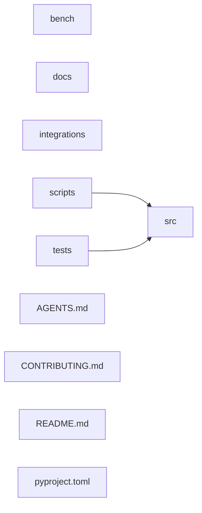

# Repository map

- files: 185
- symbols: 3926
- relations: 5585
- parser issues: 1

## Top directories

- tests: 86 files, 617 symbols
- src: 40 files, 1066 symbols
- integrations: 37 files, 2232 symbols
- docs: 16 files, 0 symbols
- .: 4 files, 0 symbols
- scripts: 1 files, 11 symbols
- bench: 1 files, 0 symbols

## Entry points

- integrations/deepseek-harness/plugin/verify/bridge-smoke.mjs:73 function integrations.deepseek-harness.plugin.verify.bridge-smoke.main
- integrations/deepseek-harness/plugin/verify/harness.mjs:1071 function integrations.deepseek-harness.plugin.verify.harness.main
- scripts/bench.py:234 function scripts.bench.main
- src/codebase_intelligence/cli.py:568 function src.codebase_intelligence.cli.main
- src/codebase_intelligence/mcp/__main__.py:13 function src.codebase_intelligence.mcp.__main__.main
- src/codebase_intelligence/mcp/server.py:1 file entry point
- tests/fixtures/cli/demo_repo/src/demo/core.py:29 function tests.fixtures.cli.demo_repo.src.demo.core.main
- tests/fixtures/cli/demo_repo/web/index.ts:3 function tests.fixtures.cli.demo_repo.web.index.main
- tests/fixtures/parser/go/service/main.go:9 function tests.fixtures.parser.go.service.main.main
- tests/fixtures/parser/python_pkg/app.py:18 function tests.fixtures.parser.python_pkg.app.main
- ... 7 more entry points

## Files

### AGENTS.md (markdown, 51 lines)

- no declarations extracted (unsupported language or file-only index entry)

### CONTRIBUTING.md (markdown, 21 lines)

- no declarations extracted (unsupported language or file-only index entry)

### README.md (markdown, 213 lines)

- no declarations extracted (unsupported language or file-only index entry)

### bench/results.json (json, 314 lines)

- no declarations extracted (unsupported language or file-only index entry)

### docs/ARCHITECTURE.md (markdown, 91 lines)

- no declarations extracted (unsupported language or file-only index entry)

### docs/BENCHMARKS.md (markdown, 41 lines)

- no declarations extracted (unsupported language or file-only index entry)

### docs/DELIVERY.md (markdown, 218 lines)

- no declarations extracted (unsupported language or file-only index entry)

### docs/DESIGN_PRINCIPLES.md (markdown, 12 lines)

- no declarations extracted (unsupported language or file-only index entry)

### docs/DSH_PLUGIN.md (markdown, 529 lines)

- no declarations extracted (unsupported language or file-only index entry)

### docs/EXPORT.md (markdown, 172 lines)

- no declarations extracted (unsupported language or file-only index entry)

### docs/RESEARCH.md (markdown, 59 lines)

- no declarations extracted (unsupported language or file-only index entry)

### docs/RETRIEVAL_EVAL.md (markdown, 182 lines)

- no declarations extracted (unsupported language or file-only index entry)

### docs/ROADMAP.md (markdown, 73 lines)

- no declarations extracted (unsupported language or file-only index entry)

### docs/SCANNER_POLICY.md (markdown, 275 lines)

- no declarations extracted (unsupported language or file-only index entry)

### docs/SPEC.md (markdown, 402 lines)

- no declarations extracted (unsupported language or file-only index entry)

### docs/TOKENS.md (markdown, 99 lines)

- no declarations extracted (unsupported language or file-only index entry)

### docs/VISION.md (markdown, 29 lines)

- no declarations extracted (unsupported language or file-only index entry)

### docs/acceptance/CI_CLEAN_CHECKOUT.md (markdown, 74 lines)

- no declarations extracted (unsupported language or file-only index entry)

### docs/acceptance/CLONE_REPRODUCIBILITY.md (markdown, 179 lines)

- no declarations extracted (unsupported language or file-only index entry)

### docs/acceptance/GUIDE_STYLE.md (markdown, 95 lines)

- no declarations extracted (unsupported language or file-only index entry)

### integrations/deepseek-harness/README.md (markdown, 143 lines)

- no declarations extracted (unsupported language or file-only index entry)

### integrations/deepseek-harness/plugin/PANEL_CONTRACT.md (markdown, 195 lines)

- no declarations extracted (unsupported language or file-only index entry)

### integrations/deepseek-harness/plugin/README.md (markdown, 35 lines)

- no declarations extracted (unsupported language or file-only index entry)

### integrations/deepseek-harness/plugin/client.js (javascript, 4849 lines)

- integrations/deepseek-harness/plugin/client.js:1 module integrations.deepseek-harness.plugin.client [heuristic]
- integrations/deepseek-harness/plugin/client.js:16 variable integrations.deepseek-harness.plugin.client.react `const react =` [heuristic]
- integrations/deepseek-harness/plugin/client.js:17 variable integrations.deepseek-harness.plugin.client.h `const h =` [heuristic]
- integrations/deepseek-harness/plugin/client.js:25 constant integrations.deepseek-harness.plugin.client.NS `const NS =` [heuristic]
- integrations/deepseek-harness/plugin/client.js:27 constant integrations.deepseek-harness.plugin.client.PKG_ID `const PKG_ID =` [heuristic]
- integrations/deepseek-harness/plugin/client.js:28 constant integrations.deepseek-harness.plugin.client.VERSION `const VERSION =` [heuristic]
- integrations/deepseek-harness/plugin/client.js:30 constant integrations.deepseek-harness.plugin.client.API_BASE `const API_BASE =` [heuristic]
- integrations/deepseek-harness/plugin/client.js:32 constant integrations.deepseek-harness.plugin.client.REQ_HEADER `const REQ_HEADER =` [heuristic]
- integrations/deepseek-harness/plugin/client.js:34 constant integrations.deepseek-harness.plugin.client.LANG_KEY `const LANG_KEY =` [heuristic]
- integrations/deepseek-harness/plugin/client.js:35 constant integrations.deepseek-harness.plugin.client.REQUEST_TIMEOUT_MS `const REQUEST_TIMEOUT_MS =` [heuristic]
- ... 639 more symbols in this file

### integrations/deepseek-harness/plugin/cordis.patch.yml (yaml, 41 lines)

- no declarations extracted (unsupported language or file-only index entry)

### integrations/deepseek-harness/plugin/index.js (javascript, 216 lines)

- integrations/deepseek-harness/plugin/index.js:1 module integrations.deepseek-harness.plugin.index [heuristic]
- integrations/deepseek-harness/plugin/index.js:25 variable integrations.deepseek-harness.plugin.index.inject `export const inject =` [heuristic]
- integrations/deepseek-harness/plugin/index.js:28 variable integrations.deepseek-harness.plugin.index.name `export const name =` [heuristic]
- integrations/deepseek-harness/plugin/index.js:37 function integrations.deepseek-harness.plugin.index.apply `export function apply(` [heuristic]
- integrations/deepseek-harness/plugin/index.js:38 variable integrations.deepseek-harness.plugin.index.log `const log =` [heuristic]
- integrations/deepseek-harness/plugin/index.js:66 variable integrations.deepseek-harness.plugin.index.bindings `const bindings =` [heuristic]
- integrations/deepseek-harness/plugin/index.js:68 variable integrations.deepseek-harness.plugin.index.panelDispose `let panelDispose =` [heuristic]
- integrations/deepseek-harness/plugin/index.js:70 function integrations.deepseek-harness.plugin.index.decorate `const decorate = (agent) =>` [heuristic]
- integrations/deepseek-harness/plugin/index.js:85 variable integrations.deepseek-harness.plugin.index.disposers `const disposers =` [heuristic]
- integrations/deepseek-harness/plugin/index.js:86 variable integrations.deepseek-harness.plugin.index.toolCount `let toolCount =` [heuristic]
- ... 11 more symbols in this file

### integrations/deepseek-harness/plugin/lib/bridge.js (javascript, 651 lines)

- integrations/deepseek-harness/plugin/lib/bridge.js:1 module integrations.deepseek-harness.plugin.lib.bridge [heuristic]
- integrations/deepseek-harness/plugin/lib/bridge.js:31 constant integrations.deepseek-harness.plugin.lib.bridge.ENGINE_MODULE `export const ENGINE_MODULE =` [heuristic]
- integrations/deepseek-harness/plugin/lib/bridge.js:34 constant integrations.deepseek-harness.plugin.lib.bridge.MIN_PYTHON `const MIN_PYTHON =` [heuristic]
- integrations/deepseek-harness/plugin/lib/bridge.js:37 constant integrations.deepseek-harness.plugin.lib.bridge.PROBE_TIMEOUT_MS `const PROBE_TIMEOUT_MS =` [heuristic]
- integrations/deepseek-harness/plugin/lib/bridge.js:40 constant integrations.deepseek-harness.plugin.lib.bridge.MAX_CAPTURE_BYTES `const MAX_CAPTURE_BYTES =` [heuristic]
- integrations/deepseek-harness/plugin/lib/bridge.js:43 constant integrations.deepseek-harness.plugin.lib.bridge.PROBE_SNIPPET `const PROBE_SNIPPET =` [heuristic]
- integrations/deepseek-harness/plugin/lib/bridge.js:58 function integrations.deepseek-harness.plugin.lib.bridge.candidateList `export function candidateList(` [heuristic]
- integrations/deepseek-harness/plugin/lib/bridge.js:59 variable integrations.deepseek-harness.plugin.lib.bridge.list `const list =` [heuristic]
- integrations/deepseek-harness/plugin/lib/bridge.js:60 variable integrations.deepseek-harness.plugin.lib.bridge.seen `const seen =` [heuristic]
- integrations/deepseek-harness/plugin/lib/bridge.js:61 function integrations.deepseek-harness.plugin.lib.bridge.add `const add = (command, args = [], label = '') =>` [heuristic]
- ... 87 more symbols in this file

### integrations/deepseek-harness/plugin/lib/config.js (javascript, 211 lines)

- integrations/deepseek-harness/plugin/lib/config.js:1 module integrations.deepseek-harness.plugin.lib.config [heuristic]
- integrations/deepseek-harness/plugin/lib/config.js:17 constant integrations.deepseek-harness.plugin.lib.config.TOOL_IDS `export const TOOL_IDS =` [heuristic]
- integrations/deepseek-harness/plugin/lib/config.js:27 constant integrations.deepseek-harness.plugin.lib.config.TOOL_KEYS `export const TOOL_KEYS =` [heuristic]
- integrations/deepseek-harness/plugin/lib/config.js:30 constant integrations.deepseek-harness.plugin.lib.config.DEFAULT_MAX_TOKENS `export const DEFAULT_MAX_TOKENS =` [heuristic]
- integrations/deepseek-harness/plugin/lib/config.js:40 constant integrations.deepseek-harness.plugin.lib.config.MAX_TOKENS_LIMIT `export const MAX_TOKENS_LIMIT =` [heuristic]
- integrations/deepseek-harness/plugin/lib/config.js:46 constant integrations.deepseek-harness.plugin.lib.config.MIN_MAX_TOKENS `export const MIN_MAX_TOKENS =` [heuristic]
- integrations/deepseek-harness/plugin/lib/config.js:49 constant integrations.deepseek-harness.plugin.lib.config.DEFAULT_TIMEOUT_MS `export const DEFAULT_TIMEOUT_MS =` [heuristic]
- integrations/deepseek-harness/plugin/lib/config.js:52 constant integrations.deepseek-harness.plugin.lib.config.DEFAULT_MAX_FILE_BYTES `export const DEFAULT_MAX_FILE_BYTES =` [heuristic]
- integrations/deepseek-harness/plugin/lib/config.js:55 constant integrations.deepseek-harness.plugin.lib.config.DEFAULT_EXPORT_DIR `export const DEFAULT_EXPORT_DIR =` [heuristic]
- integrations/deepseek-harness/plugin/lib/config.js:58 constant integrations.deepseek-harness.plugin.lib.config.DATA_DIR_NAME `export const DATA_DIR_NAME =` [heuristic]
- ... 27 more symbols in this file

### integrations/deepseek-harness/plugin/lib/panel.js (javascript, 538 lines)

- integrations/deepseek-harness/plugin/lib/panel.js:1 module integrations.deepseek-harness.plugin.lib.panel [heuristic]
- integrations/deepseek-harness/plugin/lib/panel.js:27 constant integrations.deepseek-harness.plugin.lib.panel.REQUEST_HEADER `export const REQUEST_HEADER =` [heuristic]
- integrations/deepseek-harness/plugin/lib/panel.js:29 constant integrations.deepseek-harness.plugin.lib.panel.ROUTE_PREFIX `export const ROUTE_PREFIX =` [heuristic]
- integrations/deepseek-harness/plugin/lib/panel.js:31 constant integrations.deepseek-harness.plugin.lib.panel.MAX_BODY_BYTES `export const MAX_BODY_BYTES =` [heuristic]
- integrations/deepseek-harness/plugin/lib/panel.js:33 constant integrations.deepseek-harness.plugin.lib.panel.GET `const GET =` [heuristic]
- integrations/deepseek-harness/plugin/lib/panel.js:34 constant integrations.deepseek-harness.plugin.lib.panel.POST `const POST =` [heuristic]
- ... truncated: document size bound reached.

## Project graph

Top-level directories and files with resolved imports between them.
Showing 10 of 10 top-level nodes.
The [saved graph](graph.snapshot.json) includes the full directory, file, and symbol data.

